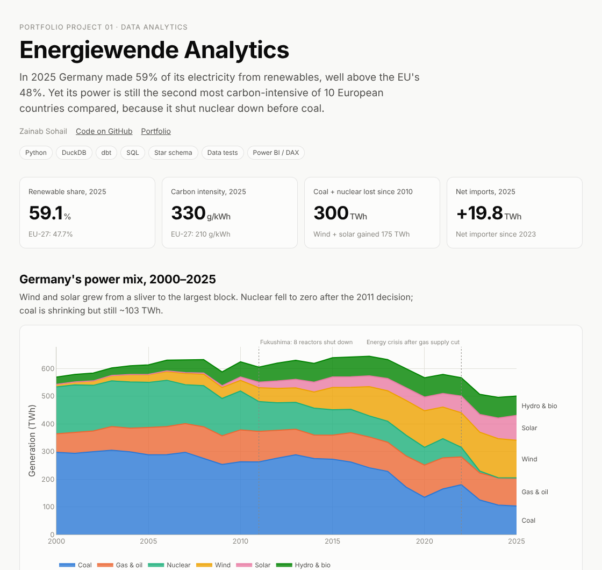
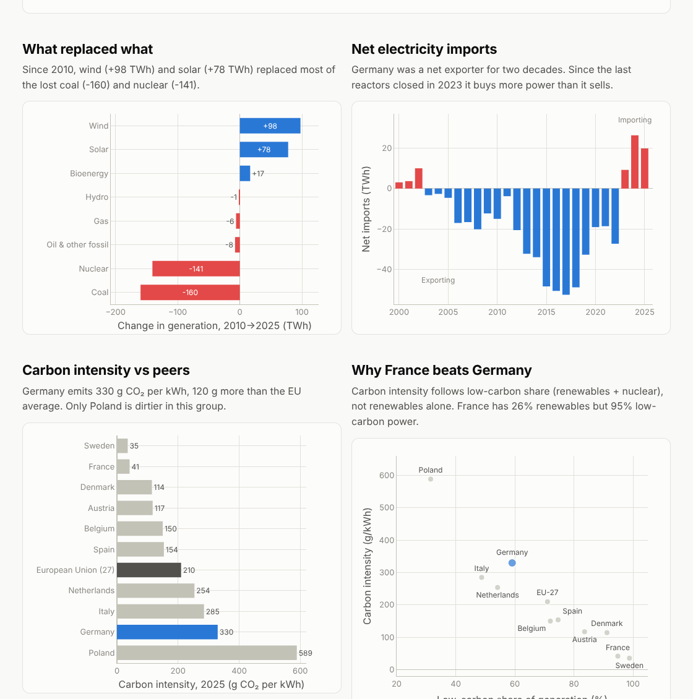
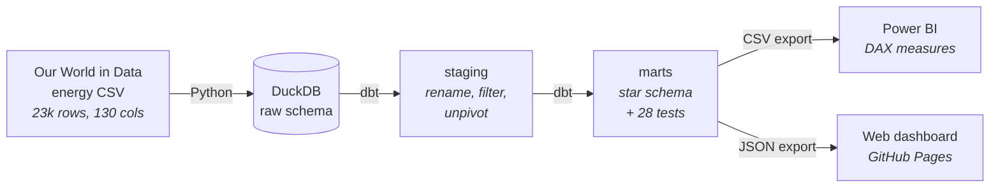
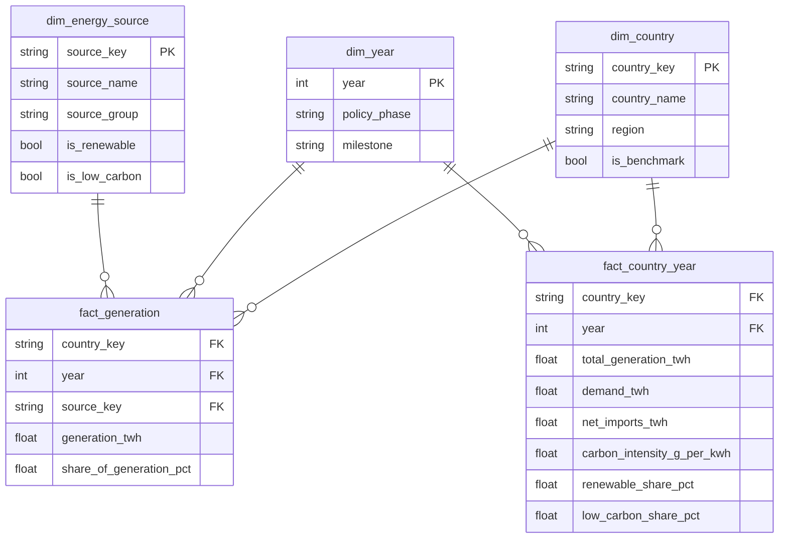

# Energiewende Analytics

**Germany's electricity transition, 2000–2025, compared with nine EU countries.**
An end-to-end analytics project: raw public data → tested star schema in dbt + DuckDB → Power BI report and a live web dashboard.

[**→ Live dashboard**](https://xo58gole.github.io/energiewende-analytics/) &nbsp;·&nbsp;
[Power BI build guide](powerbi/BUILD_GUIDE.md) &nbsp;·&nbsp;
[Data model](#the-data-model) &nbsp;·&nbsp;
[Run it yourself](#run-it-yourself)


<picture>
  <source media="(prefers-color-scheme: dark)" srcset="docs/img/dashboard-hero-dark.png">
  
</picture>

---

## The question

Germany has spent 25 years on the *Energiewende*, its shift away from fossil and nuclear power.
Is its electricity actually cleaner than its neighbours', and what replaced the coal and nuclear it switched off?

## What the data says (2025)

| Finding | Number |
| --- | --- |
| Germany's renewable share is well above the EU average | **59.1%** vs EU-27 47.7% |
| …but its power is still the second dirtiest of the 10 countries compared | **330 g CO₂/kWh** vs EU-27 210 |
| Since 2010, coal and nuclear output fell by | **−300 TWh** (coal −160, nuclear −141) |
| Wind and solar grew by | **+175 TWh** (wind +98, solar +78) |
| Germany went from net exporter to net importer | **+19.8 TWh** imported in 2025 (importer since 2023) |

**The business takeaway:** carbon intensity tracks *low-carbon* share (renewables + nuclear), not renewables alone.
France has only 26% renewables but 95% low-carbon power, so it emits 41 g/kWh, an eighth of Germany's.
Germany replaced nuclear with renewables instead of replacing coal first, so its emissions fell more slowly than its renewable share grew.
Total generation fell by 124 TWh since 2010; demand dropped 89 TWh and imports covered the rest (a 35 TWh swing from exporting to importing).



---

## How it's built



| Layer | What happens | Where |
| --- | --- | --- |
| Extract & load | Download the CSV and load it untouched into `raw.owid_energy` | [`ingest/load_raw.py`](ingest/load_raw.py) |
| Staging | Keep only the electricity columns (out of 130), rename to clear units, filter to 11 countries from 2000, unpivot sources to long format | [`dbt/models/staging`](dbt/models/staging) |
| Marts | Star schema: 3 dimensions, 2 fact tables, KPIs pre-computed | [`dbt/models/marts`](dbt/models/marts) |
| Tests | Keys unique and not null, every foreign key resolves, values in range, sources add up to the reported total | [`schema.yml`](dbt/models/marts/schema.yml), [`tests/`](dbt/tests) |
| Serve | Star schema to CSV for Power BI; headline numbers to `docs/data.js` for the web page | [`analysis/build_outputs.py`](analysis/build_outputs.py) |

### The data model



Two grains on purpose: `fact_generation` is country × year × source (for mix and change analysis);
`fact_country_year` is country × year (for totals, imports and carbon intensity, which aren't additive across sources).
`dim_year` carries Germany's policy milestones (EEG 2000, Fukushima 2011, coal exit law 2020, energy crisis 2022, last reactors 2023), so any chart can be annotated from the model.

### Data quality

All 28 dbt tests pass. One judgement call is worth calling out:
the EU-27 totals for 2000–2003 are 0.8–1.5% higher than the sum of their sources, because the upstream aggregate is missing some source detail for those years.
The `sources_add_up_to_total` test therefore allows up to 2% difference. Every individual country matches exactly.

---

## Run it yourself

You need Python 3.11+. In PowerShell (Windows):

```powershell
git clone https://github.com/xo58gole/energiewende-analytics.git
cd energiewende-analytics
python -m venv .venv
.venv\Scripts\Activate.ps1
pip install -r requirements.txt
.\run_pipeline.ps1
```

macOS/Linux: same steps, with `source .venv/bin/activate` and `./run_pipeline.sh`.

That downloads the data (~9 MB), builds the database, runs all tests and refreshes `exports/` and `docs/data.js`.
Open `docs/index.html` to see the dashboard, or follow the [Power BI build guide](powerbi/BUILD_GUIDE.md).

Handy dbt commands (run inside `dbt/`):

```powershell
dbt build --profiles-dir .          # models + tests
dbt docs generate --profiles-dir .  # documentation site with lineage graph
dbt docs serve --profiles-dir .
```

## Repo layout

```
energiewende-analytics/
├── ingest/load_raw.py          # download + load raw data into DuckDB
├── dbt/
│   ├── models/staging/         # cleaning and reshaping
│   ├── models/marts/           # star schema + schema tests
│   ├── seeds/                  # country scope, energy source groups
│   ├── tests/                  # custom data test
│   └── macros/                 # small generic tests, schema naming
├── analysis/build_outputs.py   # exports for Power BI and the web page
├── exports/                    # star schema as CSV (Power BI source)
├── powerbi/                    # DAX measures, theme, build guide
├── docs/                       # web dashboard (GitHub Pages)
└── run_pipeline.ps1 / .sh      # one command to rebuild everything
```

## What I'd add next

- Hourly data from the ENTSO-E Transparency Platform to look at prices and the "Dunkelflaute" (windless, dark periods).
- A scheduled GitHub Action that reruns the pipeline monthly and fails loudly if a test breaks.
- Incremental dbt models once the data is large enough to need them.

## Data and licence

Data: [Our World in Data energy dataset](https://github.com/owid/energy-data) (CC BY 4.0), built on Ember and the Energy Institute *Statistical Review of World Energy*.
Code: MIT licence.

---

**Zainab Sohail** · MSc Artificial Intelligence, FAU Erlangen-Nürnberg · [Portfolio](https://xo58gole.github.io/)
